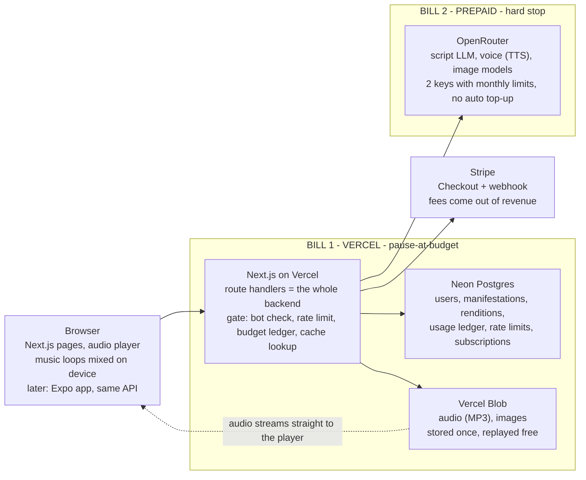

# Neville architecture: what the website page showed

Archive, 2026-11-25. The `/architecture` page on the website was removed (Tim: "You can drop the architecture page"; vendors and prices stay documented because "understanding cost is part of the PRD"). This file keeps the page's content as text so it survives the page being deleted. The numbers still live in `lib/architecture.ts` (kept as is), and the written decision record is `docs/specs/architecture.md`. Prices were read 17 Nov 2026; mid and premium voice prices come from search extracts of OpenRouter pages and should be re-checked before choosing a tier.

## Headline

Next.js on Vercel, with the database and files on the Vercel bill, and every AI call through OpenRouter on prepaid credits. No separate backend.

- **2 bills.** Vercel and OpenRouter. Stripe takes its fee from revenue.
- **$48-94** a month at 100 active users (cheap to mid voice).
- **$0.22-0.68** variable cost per active user per month.

## Diagram, as text

Two bills. The spend that grows with usage sits on the prepaid side.

- **Bill 1, Vercel, pause-at-budget** contains:
  - **Next.js on Vercel**: route handlers are the whole backend; `/api/generate` (script, then voice, then image); auth, share pages, Stripe webhook. Gate on every paid call: bot check, then rate limit, then budget ledger, then cache lookup.
  - **Neon Postgres**: users, manifestations, renditions, usage ledger, rate limits, subscriptions. One database, plain SQL.
  - **Vercel Blob**: audio (MP3) and images, stored once and replayed free, keyed by content hash, behind a storage interface.
- **Bill 2, prepaid, hard stop** contains:
  - **OpenRouter**, the model router: script LLM, voice (TTS) models, image models. Two keys, each with a monthly limit; no auto top-up.
- **Outside the bills:**
  - **Browser**: Next.js pages, audio player, music loops mixed on the device. Later: the Expo app, same API.
  - **Stripe**: Checkout and webhook; fees come out of revenue.

Arrows: Browser to Next.js; Next.js to Neon Postgres; Next.js to Vercel Blob; Next.js to OpenRouter; Next.js to Stripe; Vercel Blob to the Browser (dashed: audio streams straight from storage to the player).



The original drawing (an inline SVG React component, `app/architecture/Diagram.tsx`) is kept below so it can be restored.

<details>
<summary>Original <code>Diagram.tsx</code></summary>

```tsx
const box = { fill: "#1b2030", stroke: "#2f3647", rx: 12 };
const t = { fill: "#ffffff", fontSize: 15, fontWeight: 600 } as const;
const s = { fill: "#a1a0a3", fontSize: 12 } as const;
const arrow = { stroke: "#6c9bff", strokeWidth: 1.6, fill: "none", markerEnd: "url(#a)" };

export default function Diagram() {
  return (
    <svg viewBox="0 0 900 470" role="img" aria-labelledby="dg-title dg-desc">
      <title id="dg-title">Neville architecture</title>
      <desc id="dg-desc">
        The browser talks to a Next.js app on Vercel. Vercel functions use Neon Postgres and
        Vercel Blob, which are on the Vercel bill, and call OpenRouter, which runs on prepaid
        credits. Stripe takes payments.
      </desc>
      <defs>
        <marker id="a" viewBox="0 0 10 10" refX="9" refY="5" markerWidth="7" markerHeight="7" orient="auto">
          <path d="M0 0 L10 5 L0 10 z" fill="#6c9bff" />
        </marker>
      </defs>

      {/* Bill 1 */}
      <rect x="250" y="20" width="390" height="430" rx="18" fill="none" stroke="#6c9bff" strokeDasharray="6 6" />
      <text x="266" y="44" fill="#6c9bff" fontSize="12" fontWeight="600">
        BILL 1 · VERCEL · pause-at-budget
      </text>

      {/* Bill 2 */}
      <rect x="670" y="20" width="215" height="250" rx="18" fill="none" stroke="#58c98d" strokeDasharray="6 6" />
      <text x="686" y="44" fill="#58c98d" fontSize="12" fontWeight="600">
        BILL 2 · PREPAID · hard stop
      </text>

      {/* Client */}
      <rect x="15" y="150" width="200" height="120" {...box} />
      <text x="31" y="180" {...t}>Browser</text>
      <text x="31" y="202" {...s}>Next.js pages, audio player</text>
      <text x="31" y="220" {...s}>music loops mixed on device</text>
      <text x="31" y="248" {...s} fill="#6c9bff">later: Expo app, same API</text>

      {/* Vercel functions */}
      <rect x="270" y="60" width="350" height="170" {...box} />
      <text x="286" y="88" {...t}>Next.js on Vercel</text>
      <text x="286" y="110" {...s}>Route handlers = the whole backend</text>
      <text x="286" y="136" {...s}>• /api/generate  (script → voice → image)</text>
      <text x="286" y="154" {...s}>• auth, share pages, Stripe webhook</text>
      <text x="286" y="180" {...s} fill="#f08a8a">Gate on every paid call: bot check →</text>
      <text x="286" y="198" {...s} fill="#f08a8a">rate limit → budget ledger → cache lookup</text>

      {/* Postgres */}
      <rect x="270" y="270" width="165" height="160" {...box} />
      <text x="286" y="298" {...t}>Neon Postgres</text>
      <text x="286" y="320" {...s}>users, manifestations,</text>
      <text x="286" y="338" {...s}>renditions, usage ledger,</text>
      <text x="286" y="356" {...s}>rate limits, subscriptions</text>
      <text x="286" y="390" {...s} fill="#6c9bff">one database, plain SQL</text>

      {/* Blob */}
      <rect x="455" y="270" width="165" height="160" {...box} />
      <text x="471" y="298" {...t}>Vercel Blob</text>
      <text x="471" y="320" {...s}>audio (MP3), images</text>
      <text x="471" y="338" {...s}>stored once, replayed free</text>
      <text x="471" y="356" {...s}>keyed by content hash</text>
      <text x="471" y="390" {...s} fill="#6c9bff">behind a storage interface</text>

      {/* OpenRouter */}
      <rect x="690" y="60" width="180" height="190" {...box} />
      <text x="706" y="88" {...t}>OpenRouter</text>
      <text x="706" y="110" {...s}>the model router</text>
      <text x="706" y="136" {...s}>• script LLM</text>
      <text x="706" y="154" {...s}>• voice (TTS) models</text>
      <text x="706" y="172" {...s}>• image models</text>
      <text x="706" y="204" {...s} fill="#58c98d">2 keys, each with a</text>
      <text x="706" y="222" {...s} fill="#58c98d">monthly limit; no auto top-up</text>

      {/* Stripe */}
      <rect x="690" y="300" width="180" height="100" {...box} />
      <text x="706" y="328" {...t}>Stripe</text>
      <text x="706" y="350" {...s}>Checkout + webhook</text>
      <text x="706" y="372" {...s}>fees come out of revenue</text>

      {/* Arrows */}
      <path d="M215 195 H268" {...arrow} />
      <path d="M352 230 V268" {...arrow} />
      <path d="M537 230 V268" {...arrow} />
      <path d="M620 130 H688" {...arrow} />
      <path d="M620 215 C655 215 650 345 688 345" {...arrow} />
      <path d="M455 440 C300 468 110 420 110 272" {...arrow} strokeDasharray="4 4" />
      <text x="15" y="300" {...s}>audio streams straight</text>
      <text x="15" y="318" {...s}>from storage to the player</text>
    </svg>
  );
}
```

</details>

## The stack

| Concern | Choice | Why |
| --- | --- | --- |
| Web app and API | Next.js on Vercel Pro | Route handlers are the whole backend. The Expo app reuses them later. |
| Database | Neon Postgres, via Vercel Marketplace | Plain SQL, on the Vercel invoice, portable. |
| Files | Vercel Blob | Same bill. Audio is stored once and replayed free. |
| Script, voice, images | OpenRouter | The model router: swap voice models by changing an id. Prepaid. |
| Auth | Better Auth, Google sign-in | No extra vendor. Users live in our database. |
| Bots and rate limits | Vercel BotID + Postgres counters | No extra vendor. |
| Payments | Stripe Checkout | Fees come out of revenue. |
| Music | Static loops, mixed on the device | Zero marginal cost. |

## Monthly cost

Per active user: 4 manifestations a month with 2 variations each (2-minute audio), 4 images each, 20 listens, plus 5 wasted anonymous trials.

| Service | 10 users | 100 users | 1,000 users |
| --- | --- | --- | --- |
| Vercel Pro | $20.00 | $20.00 | $20.00 |
| Neon Postgres | $5.00 | $5.00 | $19.00 |
| Vercel Blob | $0.10 | $0.95 | $9.45 |
| Scripts | $0.60 | $5.95 | $59.50 |
| Images | $1.28 | $12.80 | $128.00 |
| Voice, cheap tier | $0.19 | $1.90 | $18.97 |
| Voice, mid tier | $4.59 | $45.90 | $459.00 |
| OpenRouter fee, 5.5% | $0.11–0.36 | $1.14–3.56 | $11–36 |
| **Total, cheap voice** | $27 | $48 | $266 |
| **Total, mid voice** | $32 | $94 | $731 |
| Total, premium voice | $53 | $304 | $2,829 |

### Voice tiers on OpenRouter

| Tier | Models | Per 1M characters | Per 2-min audio |
| --- | --- | --- | --- |
| Cheap | Kokoro 82M | $0.62 | $0.001 |
| Mid | Grok Voice, AssemblyAI, MAI-Voice | ≈ $15 | $0.027 |
| Premium | ElevenLabs v4 | $40–80 | $0.07–0.14 |

## Budget guardrails

| Guardrail | What it does |
| --- | --- |
| Per-user allowance | Each account has a monthly allowance of voice characters and images. A generation is refused when it is spent. Premium voices use it up faster. |
| Retries are free | Every generation has a key; a retry returns the same job instead of paying twice. |
| Length caps | 280 characters in. Script length capped by plan. |
| Anonymous budget | 1 real generation per visitor on the cheapest voice, no image, behind a bot check, a per-IP limit and a $1-a-day global budget. When it is spent, visitors get a library manifestation, not an error. |
| Free accounts: cheap voice only | Studio voices need a subscription, so fake sign-ups cost a fraction of a cent. |
| Kill switch | One setting turns generation off. Playback, sign-in and payments keep working. |
| Usage ledger and alerts | Every model call records its cost. Email at 50% and 75% of the monthly budget. |

### Vendor backstops

| Vendor | Control | When hit |
| --- | --- | --- |
| OpenRouter | Prepaid credits, auto top-up off. Two keys with monthly limits: anonymous ($30) and members. | Requests fail. Anonymous abuse cannot touch paying users. |
| Vercel | Spend Management: notify at $30, pause at $60. | Site pauses. Last resort, not instant. |
| Neon | Compute and storage limits. | Database suspends. |

## Options rejected

| Option | Bills | At 100 users | Why |
| --- | --- | --- | --- |
| Vercel + Convex + OpenRouter + R2 | 5 vendors, 4 bills | $42–89 | Works, and gives live job status and a client that runs unchanged in Expo. But it has a proprietary data model with no SQL, and its own costing shows R2 is not needed. Expo works fine over a plain HTTP API, so Convex buys convenience, not capability. |
| Cloudflare Workers + D1 + R2, frontend on Vercel | 4 vendors, 4 bills | $31–77 | Cheapest floor and free audio egress. But Cloudflare's own voices are too flat or too expensive, so voice still goes to OpenRouter and “one bill” fails. Split deployment across two platforms. |

## Demo 1 flow

1. Visitor lands, sees one text box, an optional first name and a button. No sign-up.
2. They type what they want and tap Create.
3. Server checks: bot check, per-IP limit, daily anonymous budget. If the budget is spent, serve a library manifestation.
4. Script model writes about 8 lines in “You” statements with their first name. About $0.002.
5. Cheapest voice model reads it. Audio is stored once. About $0.0005.
6. Player opens: tap play, lines appear as spoken, optional music.
7. New variation, save, or choose a voice → sign-up. The first manifestation is already in the new account.
8. Images, studio voices, unlimited variations → paywall.

## Data model

| Table | Holds |
| --- | --- |
| `profile` | A person, or an anonymous device before sign-up. First name, plan. |
| `manifestation` | Title, what the user typed, library flag, revocable share slug. |
| `rendition` | One script and its audio. Variations are extra renditions. |
| `image` | Generated images for a manifestation. |
| `job` | One row per generation request, with an idempotency key. |
| `usage` | Every model call and what it cost. The cost dashboard is a query on this. |
| `allowance` | Monthly voice characters and images left, per profile. |
| `entitlement` | Who has paid, per provider: Stripe now, Apple and Google later. |
| `rate_limit, setting` | Counters, kill switch, daily budgets, default models. |


Marginal cost of the whole anonymous experience: under half a cent. Infrastructure is about $45 a month at 1,000 users in every design; AI spend is $200 to $2,500 and all three candidate designs use OpenRouter for voice, so the tie-break was simplicity. Delete account is one transaction plus a file clean-up job. Full SQL and the reasoning are in `docs/specs/architecture.md`.

### Notes the page carried under the cost table

- **Voice only dominates from the mid tier up.** On the cheap tier, images are the biggest line.
- **Script length is the multiplier.** A 10-minute meditation costs 5x the voice of a 2-minute one.
- **Replays are free.** Audio is generated once and stored.
- One image per manifestation instead of four cuts the image line by 75%.
- **The number to watch weekly:** OpenRouter spend in the last 7 days per paying subscriber, next to weekly revenue per subscriber.
